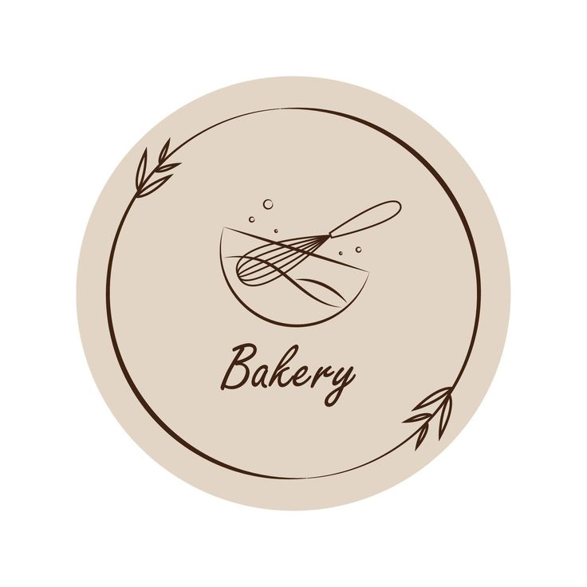
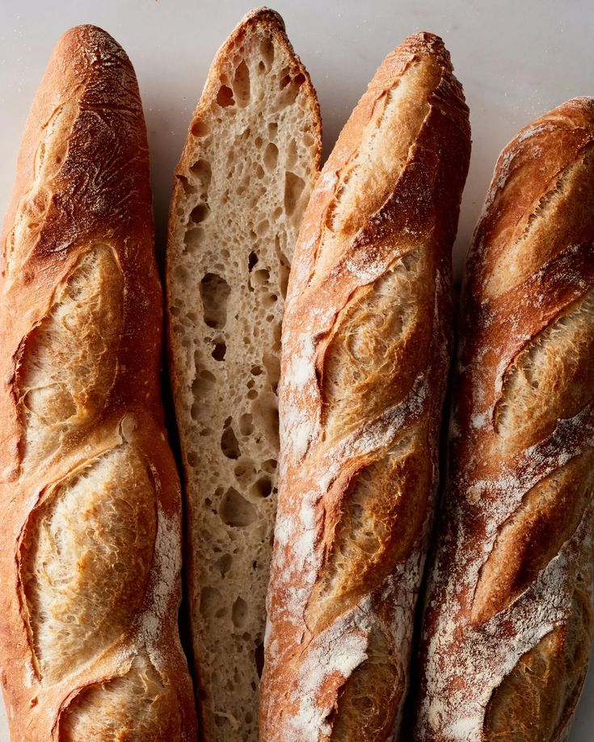
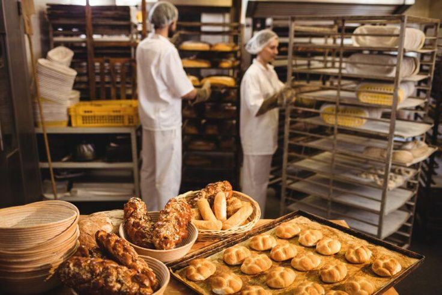

# Bakery House Website

A responsive website for "Bakery House" built using HTML5, CSS3, and JavaScript. It covers home, about us, menu, online orders, and contact inquiries, linked with interactive forms and responsive design.

> Group project for the Web Development Fundamentals (CS3251) course, Umm Al-Qura University (2024).

## Requirements Summary
- Every page shares a consistent and responsive navigation menu.
- Customers can explore detailed menus featuring bread, pastries, cakes, and beverages with descriptions and prices.
- Customers can place online orders through an interactive form with instant client-side feedback.
- Customers can send inquiries or feedback using a dedicated contact form.
- Visually appealing and organized layout designed to enhance the overall customer experience.

## Site Structure & Pages
**Pages (5):** `Index.Bakery.html`, `AboutUs.html`, `menu.html`, `order.html`, `Contact.html`

| Page | Description | Key Features |
|-------|-------------|--------------|
| Home (`Index.Bakery.html`) | Introduction to the bakery and services | Navigation links, featured bakery items |
| About Us (`AboutUs.html`) | Bakery's story, mission, and core values | Team introduction, brand philosophy |
| Menu (`menu.html`) | Comprehensive item catalog | Categories, descriptions, prices, images |
| Orders (`order.html`) | Online ordering system | Interactive form, delivery time selection, confirmation message |
| Contact Us (`Contact.html`) | Customer support and feedback channel | Inquiry form, success feedback handling via JavaScript |

## Files
- `Index.Bakery.html`, `AboutUs.html`, `menu.html`, `order.html`, `Contact.html`: main HTML pages
- `Bakery.css`: custom stylesheet for layout and design
- Images: various product and team photos (`bakery.jpg`, `baking-team.jpg`, `bread.jpg`, `cheesecake.jpg`, `chocolate-cake.jpg`, `coffee.jpg`, etc.)
- `Bakery website (bassmah.fayً).pdf`: comprehensive project report
## Screenshots & Preview

| Home Banner | Menu Preview | Our Team |
|:---:|:---:|:---:|
|  |  |  |

## How to Run
1. Clone or download this repository.
2. Open `Index.Bakery.html` in any web browser (Google Chrome, Microsoft Edge, etc.).

## Tools Used
HTML5, CSS3, JavaScript

## Team
- Fay Salman Alzahrany
- Bassmah Hassan Alzahrani
